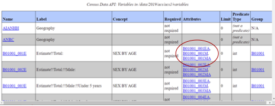

Attributes are additional variables you can include in your API call that give more information for the primary variable. For instance, they may provide labels, annotations, notes, margins of error, statistical significance, or flags that are related to your primary variable.

Attributes are available in many datasets and you can explore them in the discovery tool. For example, in the [2019 American Community Survey 1-Year dataset](https://api.census.gov/data/2019/acs/acs1/variables.html), you can see variables listed in the Attributes column of the discovery tool (shown below).

*Figure 4: Attributes for 2019 ACS 1-Year Estimates*