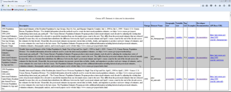

---

```markdown
---
title: "Available Datasets"
---

Determine the dataset that holds the information for which you are searching. Then decide what information you want from this dataset. The Census Bureau has already made available many datasets and is adding more almost monthly for querying with the API tool. Currently, the most popular aggregate datasets to query for variables using the API are as follows:
- American Community Survey (ACS): ACS 1-Year, ACS 5-Year, ACS Supplemental, ACS Migration Flows
- Economic Indicators Time Series
- Decennial Census
- Economic Census
- County Business Patterns and Nonemployer Statistics
- Population Estimates and Projections
- International Trade

You can find a complete list of available datasets in the [API Discovery Tool](https://api.census.gov/data.html).



*Figure 1 Datasets in the Census Data API: https://api.census.gov/data.html*
```
