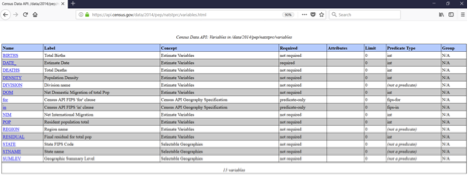
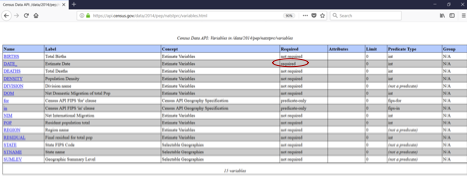

````markdown
---
title: "Core Concepts"
---

Below are the terms you will need to be familiar with when running an API query, like this one for the dataset, Vintage 2014 Population Estimates: US, State, and PR Total Population and Components of Change (Use Firefox or Chrome):

`https://api.census.gov/data/2014/pep/natstprc?get=STNAME,POP&DATE_=7&for=state:*`

> **Tip**: We recommend that you use Chrome or Firefox when building and running API queries.

### Variables

A variable is each unit of data you are searching for in a dataset. Each variable that you can search for in a dataset has a name, which may be an acronym or meaningful on its own; e.g., STNAME, POP, DATE_.

In larger datasets, such as the American Community Survey, many of these names are based on an alphanumeric code; e.g., B01003_001E (Total Population).

You can find the list of variables in the dataset by visiting the variables page. For example, the [variables page for the Vintage 2014 Population Estimates: US, State, and PR Total Population and Components of Change](https://api.census.gov/data/2014/pep/natstprc/variables.html).



*Figure 2: Variable Table for 2014 Population Estimates: US, State, and PR Total Population and Components of Change*

You can include up to 50 variables in the same API call, separated by commas.

### Required Variables

Most of the time, you have the option to choose the variables you want to include in your API call, but occasionally some datasets have required variables. Required variables are the parameters that you need to include in your search; otherwise, your search will produce no data and will return an error message. The variable table for each dataset lists which variables are required, as shown below in the variables page for the [2014 Population Estimates (Total and Components of Change) Dataset](https://api.census.gov/data/2014/pep/natstprc/variables.html).



*Figure 3: Variable Table for 2014 Population Estimates: US, State, and PR Total Population and Components of Change*

### Attributes

Attributes are additional variables you can include in your API call that give more information for the primary variable. For instance, they may provide labels, annotations, notes, margins of error, statistical significance, or flags that are related to your primary variable.

Attributes are available in many datasets and you can explore them in the discovery tool. For example, in the [2019 American Community Survey 1-Year dataset](https://api.census.gov/data/2019/acs/acs1/variables.html), you can see variables listed in the Attributes column of the discovery tool (shown below).


*Figure 4: Attributes for 2019 ACS 1-Year Estimates*

### Get Function

The get function (get=) specifies the required and selected variables you are requesting the API to give you. For example (use Chrome or Firefox):

`https://api.census.gov/data/2014/pep/natstprc?get=STNAME,POP&DATE_=7&for=state:*`

### Predicate

The predicate specifies how variables should be filtered or limited, and you can create predicates of geography, string variables, numeric variables, and time (in time series datasets).

In this example, the predicate limits the search on the July 1, 2014 (&DATE_=7) population or housing unit estimate and for all states (&for=state:*):

`https://api.census.gov/data/2014/pep/natstprc?get=STNAME,POP&DATE_=7&for=state:*`

**Please note**:

- Predicates always start with an ampersand (&).
- A wildcard (:*) can be included to search for all the values of a variable. Wildcards work for geographies and string variables only.
- A variable only needs to appear once in a query ̶either in the get statement or as a predicate. In the example above, DATE_ is a predicate (&DATE_=7), so you do not need to include it in the get statement (?get=STATENAME,POP).

Below are some examples of predicates that you can use as a guide when building your queries.

***Geography***

The predicate ***&for*** restricts the variables by geography at various levels, while ***&in*** and **%20** restricts to geographic areas smaller than state level. You can include wildcards (*) along with **&for** and **&in**.

Examples to get results for a single geography:

- `&for=state:01` – restricts the result to include only Alabama
- `&for=county:001&in=state:01` – restricts the result to include only Autauga County, Alabama
- `&for=county%20(or%20part):073&in=state:01%20place:07000` – restricts the result to include the portion of Jefferson County (county:073), Alabama that is within Birmingham city (place:07000)

Examples to get results for multiple geographies:
- `&for=state:01,13` – retrieves the result for Alabama and Georgia
- `&for=state:*` – retrieves the result for all states
- `&for=county:*&in=state:01` – restricts the result to include all counties in Alabama
- `&for=county%20(or%20part):*&in=state:01%20place:62328` – restricts the result to include all counties within Prattville city (place: 62328), Alabama

> **Tip**: The “Examples” pages in the discovery tool will list the available geographic levels and predicates for your dataset so you don’t have to build these from scratch.

For more information on Census Bureau geography, visit the [Geography webpage](https://www.census.gov/programs-surveys/geography.html).

As an alternative, you may instead use &ucgid to restrict your variables by geography. For more details, see the [Ucgid Predicate](#ucgid-predicate-alternative-option-to-specify-geographies) section of this guide.

***Variables – String***

You can create a predicate of string variables with various restrictions and can include wildcards (*). Below are several examples across different surveys and programs.

Examples to get results for a single variable value:

- `&AGEGROUP=29` – restricts results to include data for people age 18 years and over (example: [2019 Population Estimates Program Characteristics of Age Groups](https://api.census.gov/data/2019/pep/charagegroups.html))
- `&POPGROUP=400` – restricts results to include data for POPGROUP code 400, which corresponds to the Hispanic or Latino population (example: [2019 ACS 1-Year Selected Population Profiles](https://api.census.gov/data/2019/acs/acs1/spp.html))
- `&GEOCOMP=A0` – restricts results to include data for the portion of your geography that is within a metropolitan/micropolitan statistical area (example: [2018 ACS 5-year Data Profiles](https://api.census.gov/data/2018/acs/acs5/profile.html))
- `&PORT=0101` – restricts the result to include data for PORT code 0101, which corresponds to Portland, ME (example: [International Trade – U.S. Exports by Port and Harmonized System](https://api.census.gov/data/timeseries/intltrade/exports/porths.html))

Examples to get results for multiple variable values:

- `&POPGROUP=400&POPGROUP=451` – restricts results to include data for POPGROUP codes 400 and 451, which are the codes for the Hispanic or Latino and Non-Hispanic white alone populations (example: [2019 ACS 1-Year Selected Population Profiles](https://api.census.gov/data/2019/acs/acs1/spp.html))
- `&PORT=0101&PORT=0501` – restricts the result to include only ports with PORT codes 0101 and 0501 which correspond to Portland, ME and Newport, RI (example: [International Trade – U.S. Exports by Port and Harmonized System](https://api.census.gov/data/timeseries/intltrade/exports/porths.html))
- `&PORT=21*` – restricts the result to include data for PORT codes starting with 21 which may include but is not limited to 2101, 2102, 2103, and 2104, etc. (example: [International Trade – U.S. Exports by Port and Harmonized System](https://api.census.gov/data/timeseries/intltrade/exports/porths.html))
- `&NAICS2017=23*` -- restricts results to include data for all available NAICS codes that begin with 23 in the construction sector (example: [2018 County Business Patterns](https://api.census.gov/data/2018/cbp.html))

> **Tip**: You can use wildcards (*) in predicates with string variables and geographies only. You cannot use wildcards in time predicates or predicates with numeric variables.

***Variables – Numeric (Integer and Float)***

You can create a predicate of a range of values for numeric (integer and float) variables. Please note that you cannot build a predicate with wildcards for numeric variables.

Examples from County Business Patterns and the American Community Survey:

- `&PAYANN=100000` – restricts the result to include data where annual payroll is equal to 100,000
- `&PAYANN=200000&PAYANN=300000` – restricts the result to include data where annual payroll is equal to 200,000 or 300,000
- `&PAYANN=0:399999` – restricts the result to include data with annual payroll less than 400,000
- `&PAYANN=400000:500000` – restricts the result to include data where annual payroll is from 400,000 to 500,000
- `&DP05_0001E=100000:999999` – restricts results to include data where total population is from 100,000 to 999,999
- `&DP03_0128PE=0:20` – restricts results to include data where the percent of people in poverty is from 0% to 20%

> **Tip**: You can use colons (:) to restrict results by a range of variable values for integer and float variables only. You cannot use colons with string variables.

***Time (Time Series Datasets Only)***

For some datasets available on the Census Data API, data are stored for multiple points of time in one dataset, rather than across several datasets for individual points of time. When this occurs, we refer to the dataset as a time series dataset. You can find the list of time series datasets in the [time series section of the API Discovery Tool](https://api.census.gov/data/timeseries.html).

You can limit by time in most time series datasets by using the predicate &time. Please note that you cannot build a predicate with wildcards (*) for time in a time series dataset. The plus sign (+) is needed for time ranges, such as the time range from 1997 to 2012 (below).

Examples:
- `&time=2015` – restricts the result to include data for 2015
- `&time=from+1997+to+2012` – restricts the result to include data from 1997 to 2012
- `&time=2015-01` – restricts the result to include data for January, 2015
- `&time=2015-Q1` – restricts the result to include data for the first quarter of 2015
- `&time=from+2015-01` – restricts the result to include data from January, 2015 to the present
- `&time=to+2015-01` – restricts the result to include data up to January, 2015
- `&time=from+2015-01+to+2015-06` – restricts the result to include data from January, 2015 to June, 2015

Some time series datasets do not include the variable “time.” Instead, they use other variables such as “Year.” For these time-related variables, check the predicate type in the discovery tool to find out whether you can filter it following the guidelines for string or numeric variables described earlier in this document.

For more information about time series datasets, see the Time Series Dataset Example – International Trade Monthly Exports section of this user guide.

### Response Format –JSON

The results from your Census Data API data queries will return in JavaScript Object Notation (JSON) format, and you can easily plug those data into the formatting file or graphic of your choice. JSON is an easy format for exchanging data between platforms using human-readable language, rivaling the popularity of XML. The Census uses a nonstandard version of JSON that is streamlined:
- Data are represented in a two-dimensional array
- Square brackets [ ] hold arrays
- Values are separated by a , (comma).

```json
[["STNAME","POP","DATE_","state"],
["Alabama","4849377","7","01"],
["Alaska","736732","7","02"],
["Arizona","6731484","7","04"],
["Arkansas","2966369","7","05"],
["California","38802500","7","06"],
…..
```

### Group Function

The group function group([insert table ID]) allows you to get results for an entire table in one easy command; e.g. group(S0101). It provides results for all variables without having to individually include them in the API call. Even if the table has more than 50 variables, the group call will provide results for all variables in that table.

For example, this API query provides results for all 912 variables for table S0101 from the American Community Survey

`https://api.census.gov/data/2019/acs/acs1/subject?get=group(S0101)&for=state:*`
````
