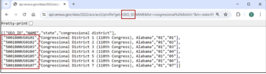
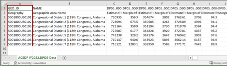

The Census Bureau offers several options to find fully qualified GEO IDs for a particular geography:
1. [TIGER/Line Shapefiles](https://www.census.gov/geographies/mapping-files/time-series/geo/tiger-line-file.html): Reference the GEOIDFQ field
2. [TIGER/Line Geodatabases](https://www.census.gov/geographies/mapping-files/time-series/geo/tiger-geodatabase-file.html): Reference the GEOIDFQ field
3. API: Include the GEO_ID variable in your API query. Example:
   
   `https://api.census.gov/data/2022/acs/acs5/profile?get=GEO_ID,NAME&for=congressional%20district:*&in=state:01`

   

   *Figure 5: Example API Query and Output with GEO_ID Variable - All Congressional Districts in Alabama from 2022 ACS 1-Year Data Profiles*

4. **data.census.gov**: Download the ZIP file for a table that includes your desired geographies. The GEO_ID column of the file will show the fully qualified GEO ID.

   

   *Figure 6: Example ZIP Download Output from data.census.gov - All Congressional Districts in Alabama from 2022 ACS 1-Year Data Profiles*

You may also find it helpful to review additional reference materials to understand GEO IDs:

- [Understanding Geographic Identifiers (GEOIDs)](https://www.census.gov/programs-surveys/geography/guidance/geo-identifiers.html) geography webpage
- [American National Standards Institute (ANSI), Federal Information Process Series (FIPS), and Other Standardized Geographic Codes](https://www.census.gov/library/reference/code-lists/ansi.html) geography webpage